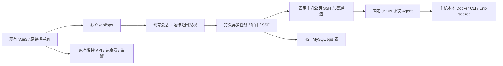

# Vue3 监控与容器运维平台验收报告

日期：2026-10-24～2026-10-25。范围：增量开发与本地隔离验收，未执行生产部署。

## 分支与交付

监控仓库从原 main/f78dfe8 检查并同步远端后，实际核实 origin/feature/vue3-frontend/9222560 的 Vue3 代码，创建 feature/container-ops-platform。原分支、提交和数据均保留。ChatChat 从已经使用 Vue3 的 main/86d496089 建立同名开发分支，仅增加接入说明。

主要实现提交：3ccd744；Linux 文件行尾：d42ffcc；代理恢复失败清理与完整链路测试：7093e69；最终 Java UTF-8 存储边界：53a5e2c。验收报告、截图和元数据为后续文档提交，不改变镜像业务代码。

后续关键修复：142d90a 按应用主机归属过滤采集快照和历史任务读取，保留原始归档；6ae0c0b 增加运行状态变更后的快照新鲜度屏障、健康稳定窗口和准确的恢复原因；87fa1a9 修复日志字节预算；3a49803 加入运维账号隔离，作为最终构建来源。

可运行交付目录：仓库根目录 **target/container-ops-delivery/**（生成产物，不提交大型二进制到 Git）：

| 文件 | 用途 |
|---|---|
| app.jar | 含 Vue3 前端的可执行 Spring Boot 平台 |
| live-monitor-platform-container-ops-20261024.tar | 约 216 MiB 离线 Docker 镜像，docker load 后可用 |
| agent/agent.py、config.example.json | 服务器侧固定 SSH 命令 Agent 与配置模板；不包含测试 SSH 入口 |
| Dockerfile、compose.yaml | 非 root 镜像构建、持久数据/日志和资源限制模板 |
| README.md、delivery-manifest.json | 安装流程、SHA256、来源提交与验收摘要 |

JAR SHA256：`74ee3e845fd5d1b5b551a50a44650de6f87ae58354983aac78f81592862f37da`。

本地镜像：`live-monitor-platform:container-ops-20261024`。镜像 ID：`sha256:9ae15d65a6731c637a704bb3f64f36f415cb9009a3ec656f7ce82de4170d7525`。构建来源：3a49803。镜像 ID 是本地构建标识，不冒充仓库 RepoDigest；本任务未推送镜像仓库。生产发布需获批后推送至实际仓库并使用返回的不可变 RepoDigest。

仓库基线跟踪了部分旧 target 文件，交付 JAR 已单独复制到上述新目录，并核对静态前端 26 个文件与构建输出逐字节一致；旧的受跟踪构建文件恢复原状，不把它们提交为新源码。不要把旧 target 的历史 JAR 当作本次交付包。

## 架构与原监控兼容

新增运维调度与工作线程独立，单主机失败不会占用原监控线程。没有新建 Docker 公网 TCP API。前端不接收 Docker 凭据或解密后的 SSH/应用 Secret。原有服务监控、主机、数据库查询、数据推送、告警渠道与规则代码保留。

## 验证结果

| 检查 | 结果与证据 |
|---|---|
| Java 单元/集成与原功能回归 | **139 项，0 失败/错误/跳过**；其中原有测试 93 项，新增运维测试 39 项、真实 Spring 上下文 7 项 |
| Vue3 单元测试 | **8 项通过**；含重复变量、值保真、内部 HTTP 幂等键、跨应用日志晚到结果隔离、取消跟踪 |
| Vue3 生产构建、Java JAR/发行包 | **通过**，JAR 内 26 个前端文件与输出内容一致 |
| Agent 纯测试 | **24 项通过**，含输入/挂载/Secret/归档安全、幂等、故障恢复、私库 Digest/身份端点、失败 Secret 清理、恢复演练停机和中文日志字节预算 |
| 真实 Docker 生命周期与卷恢复 | **通过**：拉取指定 Digest、部署、手动停止/启动、异常退出拉起、运行但 unhealthy 的恢复、限次熔断、失败升级恢复旧容器 |
| 真实数据卷备份/恢复 | **通过**：原卷保留，新卷恢复后核对文件 SHA256、UID/GID、权限；包含 UID 1000、0600 的受限文件 |
| 真实 PostgreSQL 备份/恢复 | **通过**：pg_dump → 无网络隔离验证数据库 → 原服务中的新数据库；查询结果与原库相同，原库保留。恢复失败清理改动后已额外复验 |
| H2/MySQL 迁移 | **通过**：H2 测试实际建表；隔离 MySQL 8.4 上 6 张 ops 表脚本重复执行通过，无破坏原表语句 |
| 浏览器完整业务链路 | **20 个检查通过**：页面注册主机/仓库、部署表单保存、校验、发布、版本、实时日志、停启、双服务器任务隔离、越权拦截/审计；9 个页面，1440/390 宽度无横向溢出、无页面错误 |
| 最终标准 Docker 镜像 | **healthy**；UID 10001；健康 API 200；Vue3 页面与授权 API 正常；容器内 JAR 哈希与交付一致；**未挂载 Docker socket** |

Java 调度器真实闭环额外通过：独立本地平台实例检测到 SIGKILL 引起的退出后，由 `system` 任务自动恢复（约 52 秒，包含启动宽限/采集周期）；观察到恢复事件后再次注入故障，配置上限为 1 时产生 CRITICAL/CIRCUIT_OPEN，恢复任务总数保持 1，最后通过平台主动停止。没有向生产环境注入故障。证据：[自动恢复闭环](evidence/automatic-recovery.json)。

主机数据隔离额外通过：校验新旧快照与历史任务结果中的应用绑定，不跨逻辑主机、不重复统计容器；读取过滤不覆盖原始回执。证据：[主机归属](evidence/host-scope.json)。

原始验收 JSON：[测试摘要](evidence/test-summary.json)、[浏览器](evidence/browser.json)、[Docker 生命周期](evidence/docker-lifecycle.json)、[PostgreSQL](evidence/postgres.json)、[MySQL](evidence/mysql.json)、[最终镜像](evidence/image.json)、[交付清单与校验值](evidence/delivery-manifest.json)。公开证据不包含登录会话、SSH 私钥、真实 Secret 或数据库内容。

页面截图：[平台总览](evidence/overview.png)、[部署中心](evidence/deployments.png)、[容器中心](evidence/containers.png)、[告警中心](evidence/alerts.png)、[窄屏](evidence/mobile.png)。截图数据均来自本地隔离验收，不代表生产资产。

## 已修复的基线与联调问题

- 基线 App 引用了缺失组件；新增 SidebarNav、TopHeader，复用既有 HeaderNav 和监控路由。
- 基线 Dashboard CSV 代码包含未闭合字符串；修正转义，保留导出功能。
- 基线规则解析首次加载 ANTLR 消耗请求超时预算；初始化时预热解析器，保留原请求预算。
- Spring 代理对象字段直取导致调度空指针；改为方法访问，添加实际 Spring 上下文验证。
- 打包路径和旧生成文件抢占 Vue3 入口；独立构建目录、正确 static 目标路径，并逐文件校验。
- 终态先于审计/告警可见的竞态；终态、审计、事件和失败告警原子提交。
- Unicode 字符数与 MySQL TEXT 字节容量不一致；以 UTF-8 字节限制配置、任务输入/结果，并测试中文边界。
- 同一代理存在多个逻辑主机记录时重复展示容器；采集写入、快照读取、历史任务读取统一通过应用绑定的主机过滤，原始归档保持不变。
- 自动恢复后旧快照重复触发恢复请求；以最后一次运行状态变更为屏障等待新快照，退避与 Docker starting 阶段先等待稳定。独立平台故障注入复验确认没有重复恢复任务。
- 旧监控采用登录后管理模式，新增范围账号可能绕过运维授权调用旧接口；新增授权默认限定为运维账号，后端拒绝旧管理 API，撤销授权仍保持隔离，恢复旧权限要求管理员明确确认。已有监控账号继续使用原功能；真实浏览器已验证隔离账号跳转和旧接口 403。

## 运行边界与后续环境验收

本次是功能可运行的增量版本，非生产环境容量/长稳认证。以下环境步骤不能以本地测试替代：

1. 目标服务器 Agent 安装、SSH 公钥核验、真实仓库 TLS/身份与 Secret 引用配置，需要针对实际主机授权。
2. 在现有系统内核/存储/网络下做并发容量、长时间断网、磁盘耗尽、主机重启和备份磁盘灾难恢复演练；本次未执行生产故障注入。
3. 企业私库及身份服务的具体兼容性需环境接入验收；当前支持标准 HTTPS V2、Docker 本地 auth 配置引用、允许列表内 Bearer 端点，公共仓库未开放 catalog 会明确失败，可按 repository 查询 Tags。
4. 有状态升级/回滚的数据兼容性由发布负责人确认；恢复生成新卷/新数据库，不自动覆盖或切换业务流量。卷内链接/设备文件不在当前安全归档范围。
5. 保留周期记录到期策略，不自动删除数据或备份；真实密钥仍需原密钥系统单独备份。冷备不会擅自停止业务容器。
6. INTERRUPTED/未知远端结果须先核对 Agent 日志与实际容器状态，禁止自动重跑制造重复部署。现版本按单应用容器编排，不自动改写已有多服务 Compose 栈。

阶段文件、数据库变更、测试与剩余事项详见 [03-stages.md](03-stages.md)；构建/部署/运维流程详见 [02-deployment.md](02-deployment.md)。所有改动保留在 feature/container-ops-platform，生产主分支与生产部署保持未操作状态。
